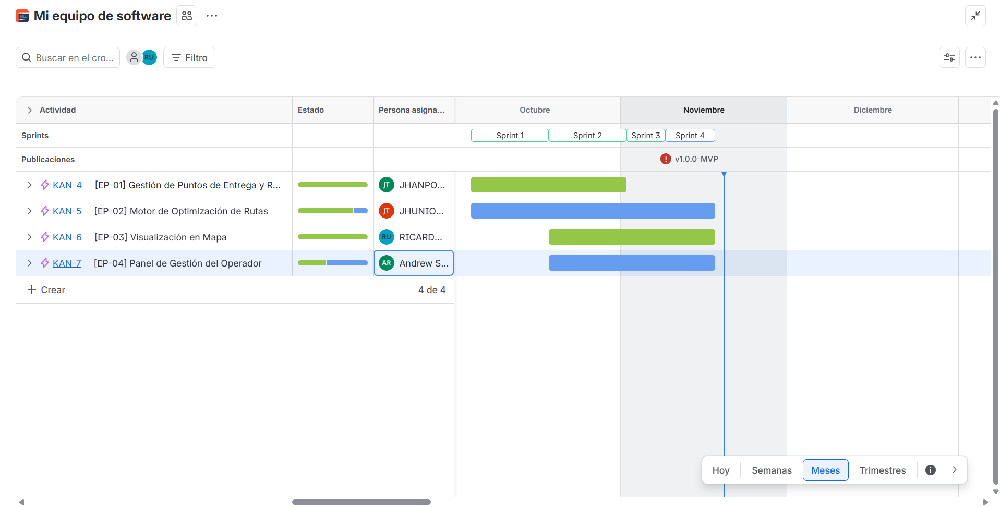
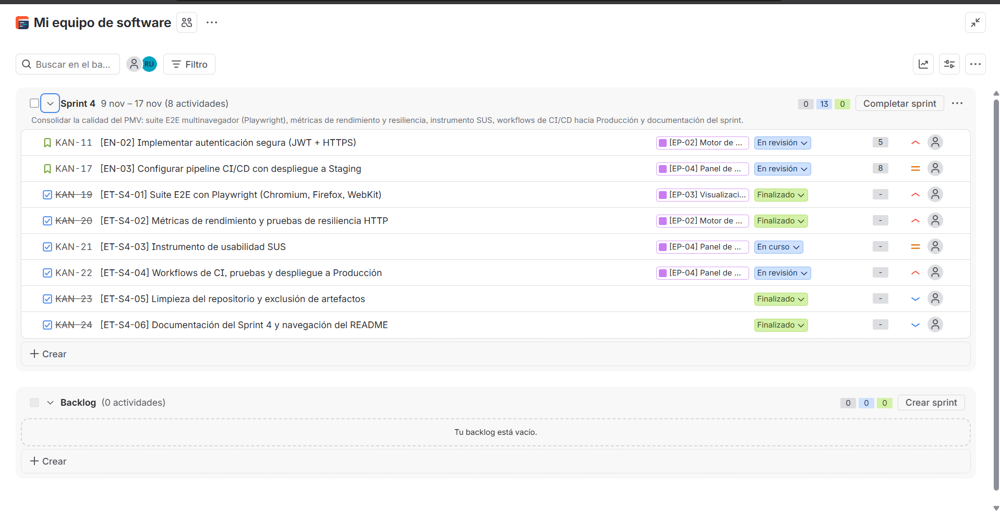
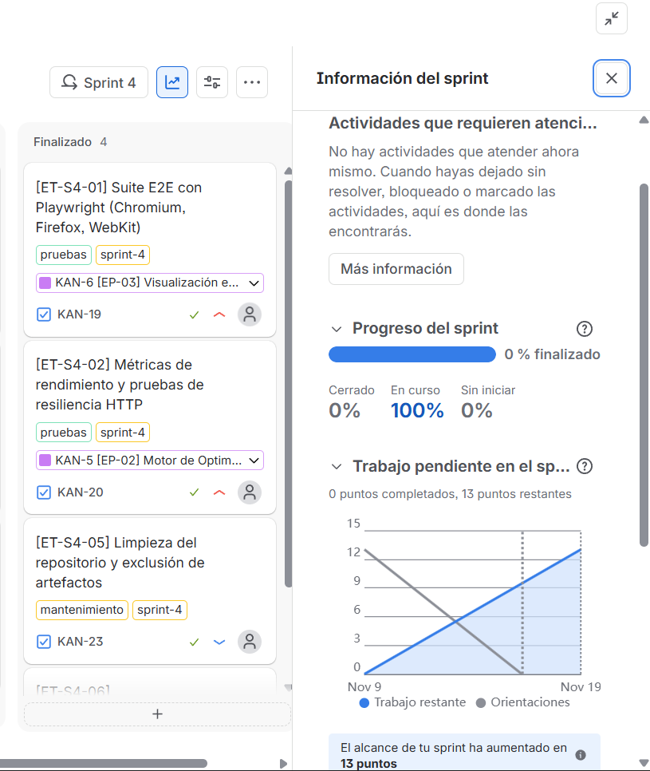
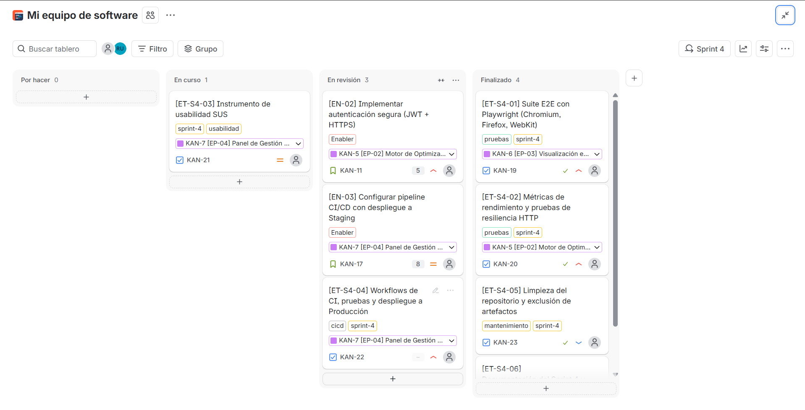
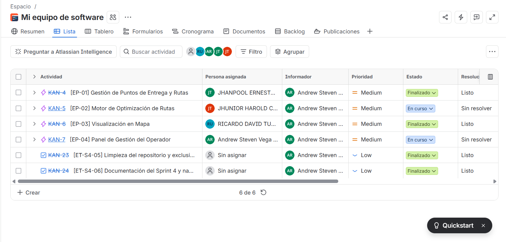

[← Volver al README Principal](../../README.md)

# Artefactos Jira

**Proyecto:** EcoLogística Lima – Optimizador de Rutas Sostenibles para DistriRápido S.A.C.
**Versión:** 1.0.0 | **Fecha:** _(completar al finalizar la configuración)_

> ⚠️ **Plantilla pendiente de evidencia real.** Las 5 secciones siguientes deben completarse con capturas de pantalla tomadas directamente del proyecto Jira del equipo. Ninguna captura puede ser generada artificialmente: la consigna exige evidencia funcional de una configuración real.
>
> **Política estricta de recorte:** cada imagen debe estar recortada exclusivamente al panel/contenedor del elemento de Jira a demostrar — sin escritorio, sin barra de tareas del sistema operativo, sin pestañas del navegador ni espacio sobrante. El incumplimiento resta el 50% del puntaje de la sección.
>
> Crea la carpeta `docs/planificacion/img/` al momento de tomar la primera captura y guarda las imágenes dentro de ella, referenciándolas con la sintaxis `` en lugar del marcador `[INSERTAR CAPTURA AQUÍ]`.

## Evidencia 1: Roadmap del Proyecto

_Mapeo de las Épicas (EP-01 a EP-04) en la línea de tiempo del proyecto._

**Descripción:** _(completar: qué rango de tiempo cubre el roadmap mostrado y cómo se distribuyen las 4 épicas)_

## Evidencia 2: Backlog Priorizado

_Vista general del backlog con Story Points estimados (secuencia de Fibonacci) y componentes asignados, según la tabla de la sección 2 de [01 Transformando a ágil](01%20Transformando%20a%20ágil%20V_1_0_0.md)._

**Descripción:** _(completar: total de Story Points visibles, orden de prioridad aplicado)_

## Evidencia 3: Sprint Planning & Sprint Goal

_Ítems seleccionados para el Sprint 1 y la meta (Sprint Goal) redactada en la cabecera del sprint._

**Sprint Goal propuesto (Sprint 1):**

> Contar con un flujo end-to-end mínimo funcional: el operador puede registrar puntos de entrega, el backend calcula una ruta optimizada básica, y ese acceso queda protegido por autenticación — sentando las bases de rendimiento y seguridad sobre las que se construirán la visualización en mapa y el resto del panel en los sprints siguientes.

**Ítems incluidos en Sprint 1:** US-001, US-003, EN-01, EN-02 (21 Story Points — ver sección 2 de [01 Transformando a ágil](01%20Transformando%20a%20ágil%20V_1_0_0.md)).

**Descripción:** Fechas configuradas en Jira para el Sprint 1: **inicio 05/10/2026 y fin 18/10/2026**. El Sprint 0 — Base del proyecto (01/10/2026 – 04/10/2026) corresponde al hito H3 del Acta de Constitución y no se registra como sprint Scrum, por no contener historias del backlog.

## Evidencia 4: Tablero Scrum Activo

_Flujo de trabajo con tarjetas distribuidas en las columnas: To Do → In Progress → In Review / QA → Done._

**Descripción:** _(completar: cuántas tarjetas hay en cada columna al momento de la captura)_

## Evidencia 5: Gestión de Versiones / Release

_Vista del módulo de Releases mostrando la versión creada (`v1.0.0-MVP`) y su asociación de historias._

**Descripción:** _(completar: nombre exacto de la versión y cantidad de historias asociadas)_

---

[← Volver al README Principal](../../README.md)
