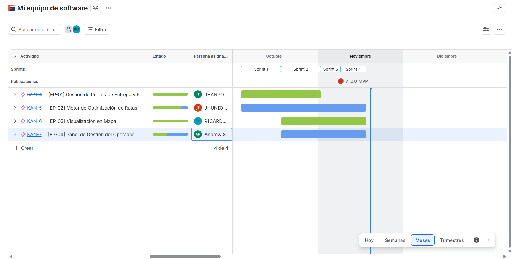
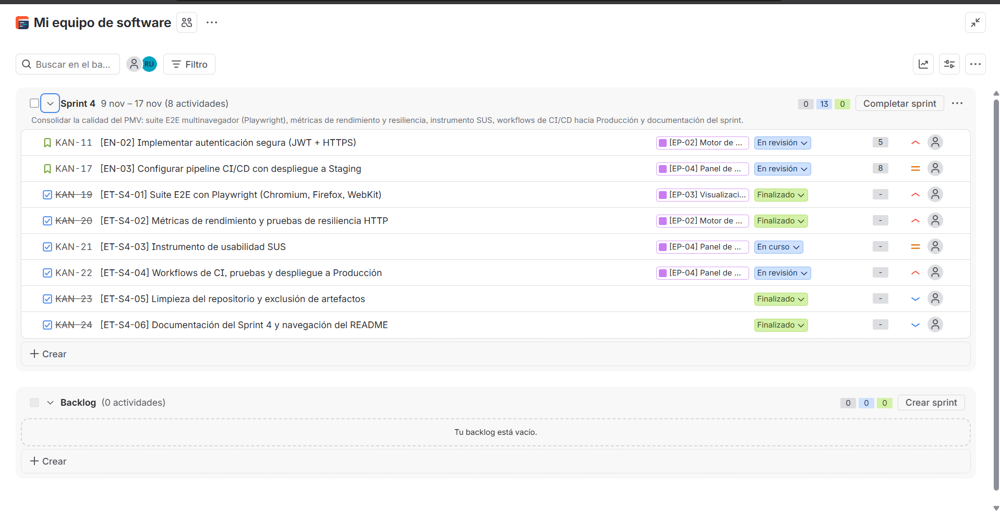
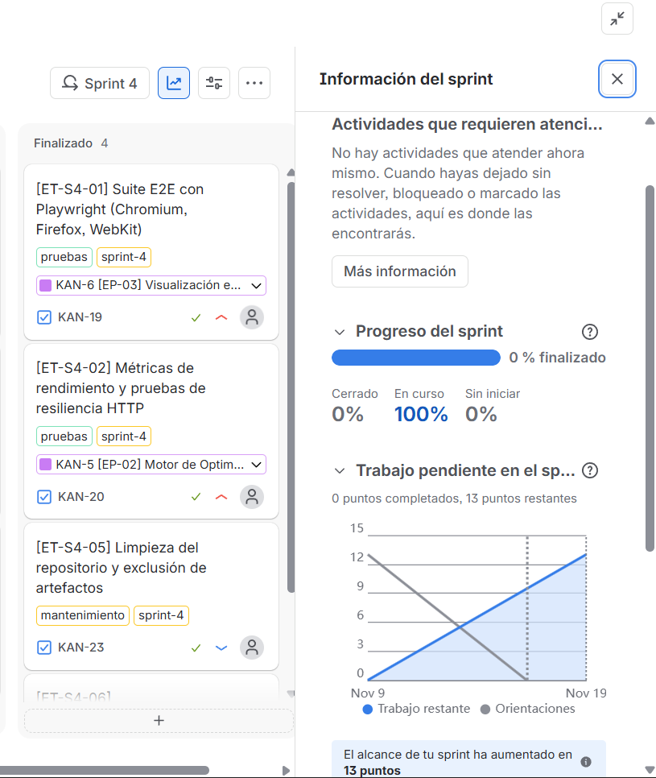
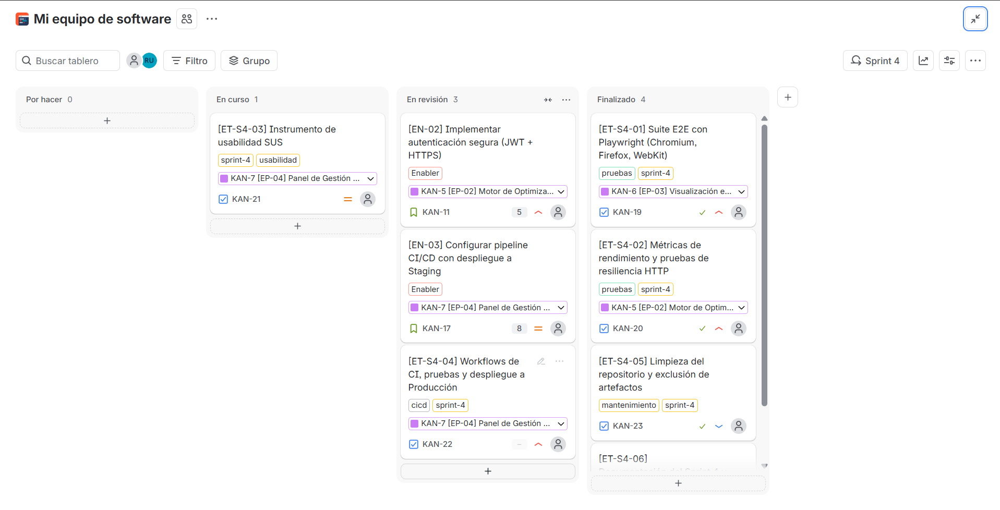
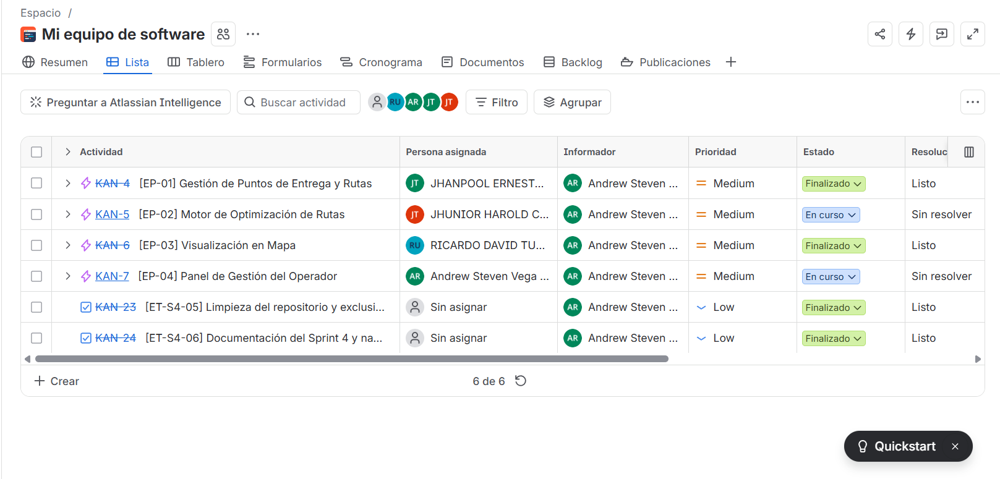

[← Volver al README Principal](../../README.md)

# Artefactos Jira

**Proyecto:** EcoLogística Lima – Optimizador de Rutas Sostenibles para DistriRápido S.A.C. 
**Versión:** 1.1.0 | **Fecha:** 25/11/2026 
**Proyecto Jira:** https://lewolfdx.atlassian.net/

## Control de Versiones del Documento

| Versión | Fecha | Autor | Descripción del Cambio |
|:---:|:---:|:---|:---|
| 1.0.0 | 10/09/2026 | Equipo EcoLogística | Plantilla inicial de artefactos de configuración de Jira. |
| 1.1.0 | 25/11/2026 | Equipo EcoLogística | Se registra la URL del proyecto Jira, se corrige la ruta real de las capturas y se aclara que la evidencia es local. El nombre del archivo se versiona para conservar el historial. |

---

> **Evidencia funcional local.** Las cinco secciones enlazan capturas del proyecto Jira almacenadas en `docs/02 Planificación/img/`. No se generan imágenes artificiales. Las descripciones que requieren lectura visual se marcan como pendientes de transcripción verificable en lugar de inventarse.
>
> **Política de recorte:** cada imagen está recortada al panel o contenedor del elemento de Jira que demuestra, sin escritorio, barra de tareas del sistema operativo, pestañas del navegador ni espacio sobrante.
>
> **Acceso en línea:** la URL del proyecto es `https://lewolfdx.atlassian.net/`. El repositorio conserva las capturas para que la evidencia sea verificable sin depender de permisos de acceso a Jira.

## Evidencia 1: Roadmap del Proyecto

_Mapeo de las Épicas (EP-01 a EP-04) en la línea de tiempo del proyecto._

**Descripción:** El rango temporal y la distribución de las cuatro épicas deben leerse directamente de `img/Cronograma.png`. No se transcriben datos que no puedan verificarse desde el archivo versionado.

## Evidencia 2: Backlog Priorizado

_Vista general del backlog con Story Points estimados (secuencia de Fibonacci) y componentes asignados, según la tabla de la sección 2 de [01 Transformando a ágil](01%20Transformando%20a%20ágil%20V_1_0_0.md)._

**Descripción:** El total de Story Points y el orden de prioridad deben leerse directamente de `img/Backlog.png`. No se transcriben datos que no puedan verificarse desde el archivo versionado.

## Evidencia 3: Sprint Planning & Sprint Goal

_Ítems seleccionados para el Sprint 1 y la meta (Sprint Goal) redactada en la cabecera del sprint._

**Sprint Goal propuesto (Sprint 1):**

> Contar con un flujo end-to-end mínimo funcional: el operador puede registrar puntos de entrega, el backend calcula una ruta optimizada básica, y ese acceso queda protegido por autenticación — sentando las bases de rendimiento y seguridad sobre las que se construirán la visualización en mapa y el resto del panel en los sprints siguientes.

**Ítems incluidos en Sprint 1:** US-001, US-003, EN-01, EN-02 (21 Story Points — ver sección 2 de [01 Transformando a ágil](01%20Transformando%20a%20ágil%20V_1_0_0.md)).

**Descripción:** Fechas configuradas en Jira para el Sprint 1: **inicio 05/10/2026 y fin 18/10/2026**. El Sprint 0 — Base del proyecto (01/10/2026 – 04/10/2026) corresponde al hito H3 del Acta de Constitución y no se registra como sprint Scrum, por no contener historias del backlog.

## Evidencia 4: Tablero Scrum Activo

_Flujo de trabajo con tarjetas distribuidas en las columnas: To Do → In Progress → In Review / QA → Done._

**Descripción:** La cantidad de tarjetas por columna debe leerse directamente de `img/Table_Scrum.png`. No se transcriben datos que no puedan verificarse desde el archivo versionado.

## Evidencia 5: Gestión de Versiones / Release

_Vista del módulo de Releases mostrando la versión creada (`v1.0.0-MVP`) y su asociación de historias._

**Descripción:** El nombre exacto de la versión y la cantidad de historias asociadas deben leerse directamente de `img/Evidencia5.png`. No se transcriben datos que no puedan verificarse desde el archivo versionado.

---

[← Volver al README Principal](../../README.md)
