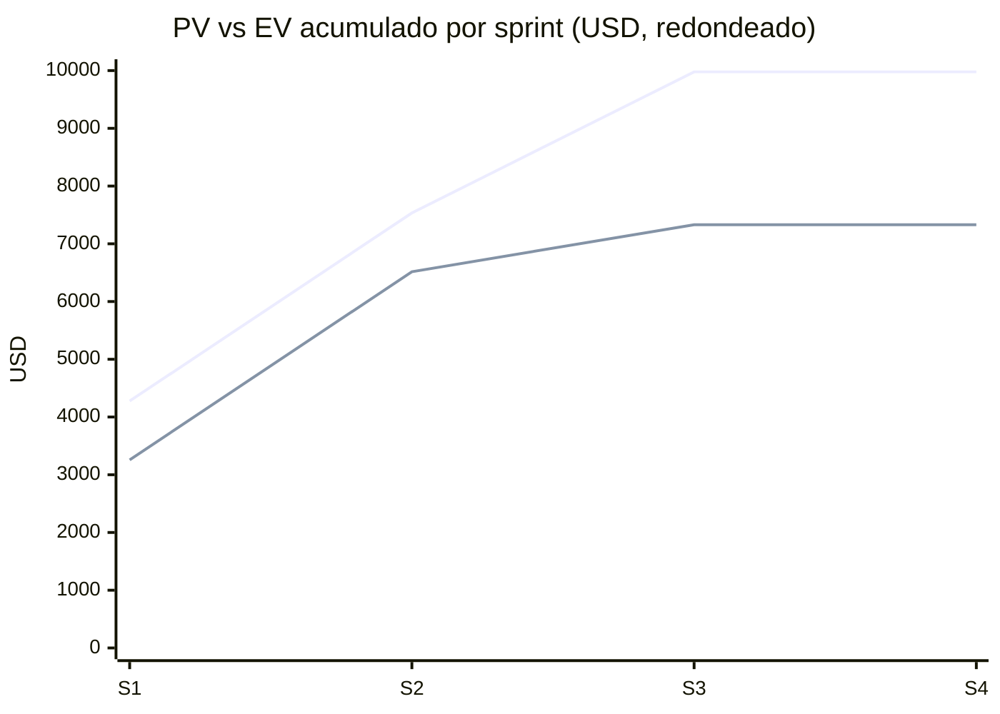
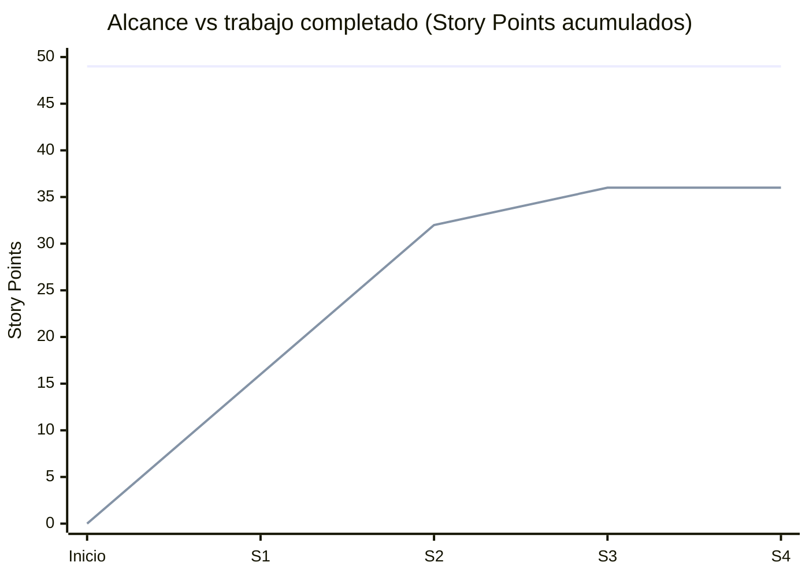
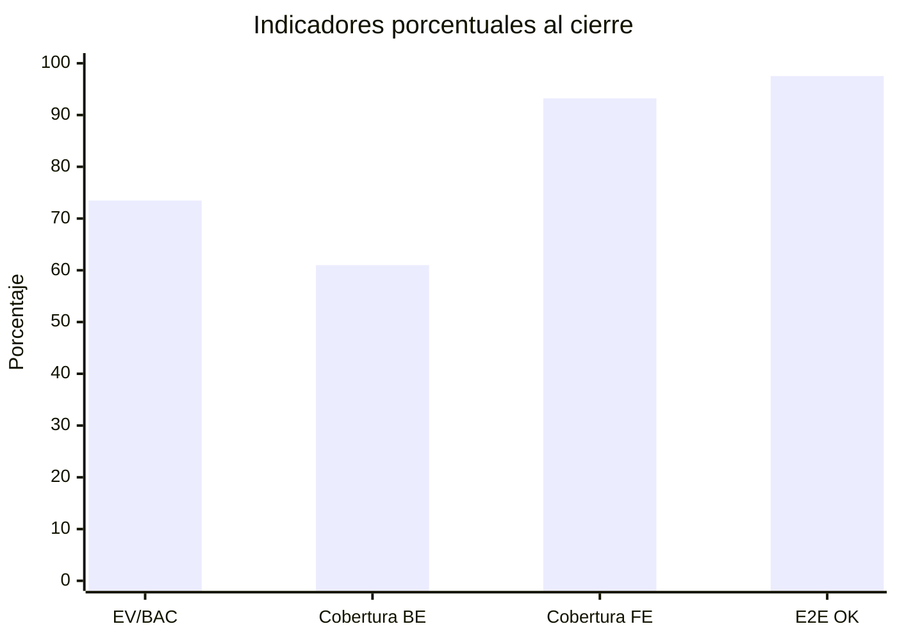

[← Volver al README Principal](../../README.md)

# 04 Tableros de Control Híbridos (Hybrid Dashboards)

**Proyecto:** EcoLogística Lima – Optimizador de Rutas Sostenibles para DistriRápido S.A.C.  
**Frecuencia de Actualización:** al cierre de cada sprint y antes de cada entrega académica; última actualización 19/11/2026  
**Versión:** 1.0.0

> Los gráficos de este documento son **diagramas estructurados generados a partir de datos
> reales del repositorio**, no capturas de herramientas inexistentes. Las cifras
> monetarias provienen del [reporte EVM](03%20Reporte%20de%20Análisis%20de%20Valor%20Ganado%20-%20EVM%20V_1_0_0.md);
> las de pruebas, del [inventario de evidencias](../Evidencias/README.md).
> Serie de cierre: [01 Estado](01%20Reporte%20de%20Estado%20V_1_0_0.md) ·
> [02 Variación](02%20Reporte%20de%20Variación%20V_1_0_0.md) ·
> [03 EVM](03%20Reporte%20de%20Análisis%20de%20Valor%20Ganado%20-%20EVM%20V_1_0_0.md) ·
> [04 Tableros](04%20Tableros%20de%20Control%20-%20Híbridos%20V_1_0_0.md) ·
> [05 Radiadores](05%20Radiadores%20de%20Información%20V_1_0_0.md) ·
> [06 Reporte Final](06%20Reporte%20Final%20del%20Proyecto%20V_1_0_0.md) ·
> [07 Lecciones](07%20Reporte%20Final%20de%20Lecciones%20Aprendidas%20V_1_0_0.md).

## 1. Justificación de Métricas (Principio Less is More)

- **Necesidades de los interesados:** la Gerencia de Operaciones y el cuerpo docente
  necesitan ver, en una sola vista, si el PMV funciona, si la línea base se cumplió y qué
  queda pendiente; el equipo necesita identificar dónde actuar en el siguiente periodo.
  No se necesita un tablero operativo en tiempo real: el proyecto es académico y no tiene
  despliegue productivo.
- **Criterios de selección de KPIs:** se eligieron siete indicadores que (a) tienen
  fuente verificable en el repositorio, (b) combinan una lectura predictiva (PV, EV, SV,
  SPI) con una adaptativa (SP cerrados, velocidad, estado de entregables), (c) son
  accionables y (d) no duplican información. Se excluyó el Mood Chart y el SUS porque no
  hay datos recolectados, y se excluyeron EAC/CPI por ausencia de AC. Mostrarlos como
  "verdes" por omisión sería engañoso.

| KPI seleccionado | Último valor verificable | Fuente |
|:---|:---|:---|
| SP cerrados / línea base | 36 / 49 (13 pendientes) | Revisiones de sprints 1–3 |
| SPI acumulado | 0.7347 | Reporte EVM |
| SV acumulado | -$2,647.25 (26.53 % del BAC) | Reporte EVM |
| Pruebas automatizadas | 66 pytest + 24 Vitest + 79 E2E aprobadas | Evidencias |
| Cobertura | backend 61 % / lógica frontend 93.22 % | Evidencias |
| Rendimiento de ruta | 17.9–20.2 ms con 20 puntos (SLA ≤ 5 s) | `test_optimizer.py` |
| Entregables de cierre | 4/6 del Sprint 4 completados; video pendiente | Revisión Sprint 4 |

## 2. Tabla Semáforo (RAG Chart) por Componente

| Componente / Entregable | Enfoque (Predictivo/Adaptativo) | Estado (🟢 Verde / 🟡 Ámbar / 🔴 Rojo) | Observación / Umbral |
|:---|:---:|:---:|:---|
| Alcance funcional del PMV (US-001 a US-008, EN-01) | Adaptativo | 🟢 Verde | PMV operativo en local; cubre los pasos 1, 2, 4, 5 y 8 del proceso logístico. |
| Hitos H1–H3 (Inicio, Planificación, base) | Predictivo | 🟢 Verde | Documentación fechada del 27/08 al 04/10/2026; sin desfase declarado. |
| Hitos H4–H5 (PMV Sprint 2 y Sprint 3) | Híbrido | 🟡 Ámbar | H4 cerrado el 01/11 (7 días después); H5 al 08/11 con EN-03 parcial. |
| Cierre H6 y aceptación formal | Predictivo | 🔴 Rojo | Previsto 15/11; al 19/11 sin sesión de aceptación ni acta de cierre. |
| Cronograma EVM (SV, SPI) | Predictivo | 🟡 Ámbar | SV -$2,647.25; SPI 0.7347; 13 SP no acreditados. |
| Costo EVM (CV, CPI, EAC) | Predictivo | 🔴 Rojo | AC no disponible: tres indicadores no evaluables. |
| Calidad de pruebas funcionales y E2E | Adaptativo | 🟢 Verde | 66/66, 24/24 y 79/81; 0 fallidas. |
| Cobertura de pruebas | Predictivo | 🟡 Ámbar | Backend 61 % (o 63 % según otro informe) < 70 % objetivo. |
| Seguridad (OWASP) | Híbrido | 🟡 Ámbar | JWT, bcrypt, roles y CSV seguro; pendientes RN-002, HTTPS, MFA y rate limiting. |
| Despliegue Staging/Producción | Predictivo | 🔴 Rojo | Workflows ejecutados, pero ambos jobs quedaron omitidos por falta de host/credenciales. |
| Sostenibilidad (Lighthouse / Green IT) | Predictivo | 🟢 Verde | Transferencia -44.58 % medida en login; con la salvedad de que solo audita esa pantalla. |
| Usabilidad (SUS) y clima (Mood) | Adaptativo | 🔴 Rojo | Instrumento SUS preparado pero no aplicado; Mood Chart sin datos. |
| Evidencia audiovisual (MP4) | Predictivo | 🔴 Rojo | Sin archivo versionado; ver [estado del entregable](../05%20Video%20proyecto/README.md). |

## 3. Gráficos de Desempeño Predictivo y Ágil

### 3.1 Tendencias de Variación y Valor Ganado (Líneas)

| Valor exacto (USD) | S1 | S2 | S3 | S4 |
|:---|---:|---:|---:|---:|
| PV acumulado | 4,276.32 | 7,534.47 | 9,978.08 | 9,978.08 |
| EV acumulado | 3,258.15 | 6,516.30 | 7,330.83 | 7,330.83 |
| SV acumulado | -1,018.17 | -1,018.17 | -2,647.25 | -2,647.25 |

**Interpretación:** el valor planificado alcanzó el 100 % del BAC al cierre del Sprint 3,
mientras el valor ganado se detuvo en 73.47 %. La brecha se abrió en el Sprint 3, cuando
EN-03 (8 SP) no pudo cerrarse sin entorno de despliegue. El Sprint 4 mantuvo ambas curvas
planas porque no había SP en el backlog ni nuevos SP cerrados.

### 3.2 Flujo Acumulado / Áreas Apiladas

| SP acumulados | Inicio | S1 | S2 | S3 | S4 |
|:---|---:|---:|---:|---:|---:|
| Alcance (línea base) | 49 | 49 | 49 | 49 | 49 |
| Completado | 0 | 16 | 32 | 36 | 36 |
| Brecha | 49 | 33 | 17 | 13 | 13 |

**Interpretación:** el alcance en SP se mantuvo estable en 49; no hubo adiciones ni
remociones de SP en la línea base. Los ítems `ET-S4-xx` del Sprint 4 son trabajo interno
fuera de esa línea base y no engrosan la curva de completado. La brecha final de 13 SP es
la misma que explica SV y SPI.

### 3.3 Relación Costo-Cronograma (SPI vs. CPI con tamaño CSI)

No se dibuja un gráfico de burbujas porque **CPI no es evaluable**: requiere AC real y no
existe. Un punto con CPI inventado daría un CSI falso. La tabla estructurada conserva la
información disponible sin fabricar el eje horizontal:

| Indicador | Valor | Estado |
|:---|:---|:---|
| SPI (eje X disponible) | 0.7347 | Calculado (36 / 49 SP) |
| CPI (eje Y requerido) | No disponible | Sin AC real |
| CSI = SPI × CPI (tamaño de burbuja) | No evaluable | Depende de CPI |
| AC requerido | No disponible | Sin registros de costos ni horas reales |

**Interpretación:** solo puede afirmarse la dimensión de cronograma. La dimensión de
costo y, por tanto, la comparación SPI vs. CPI quedan explícitamente pendientes; el
criterio para trazarla cuando exista AC está en el [reporte EVM](03%20Reporte%20de%20Análisis%20de%20Valor%20Ganado%20-%20EVM%20V_1_0_0.md#4-estimaciones-a-la-conclusión-eac).

### 3.4 Medidores de Estado (Gauges) / Gráficos de Barras

| Medidor | Valor | Umbral de referencia | Lectura |
|:---|---:|:---|:---|
| EV / BAC | 73.47 % | 100 % planeado | 🔴 Brecha de 26.53 % del BAC |
| Cobertura backend | 61 % | ≥ 70 % | 🟡 9 puntos por debajo |
| Cobertura lógica frontend | 93.22 % | ≥ 70 % | 🟢 Solo cubre `src/logica/**` |
| E2E aprobadas / ejecutadas | 97.53 % (79/81) | 0 fallidas | 🟢 2 omitidas, 0 fallidas |

**Interpretación:** la ejecución de pruebas es sólida y el motor cumple el SLA, pero el
avance de valor ganado y la cobertura backend marcan las dos brechas accionables. La
cobertura frontend es alta solo sobre lógica pura; no hay pruebas de componentes React.

---

[← Volver al README Principal](../../README.md)
