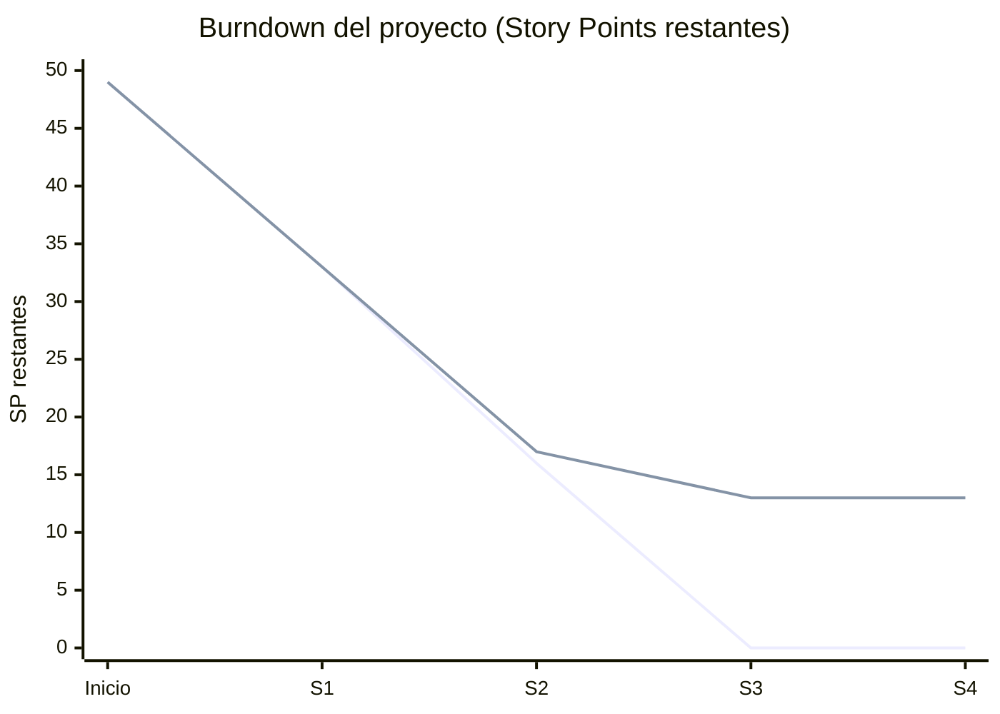
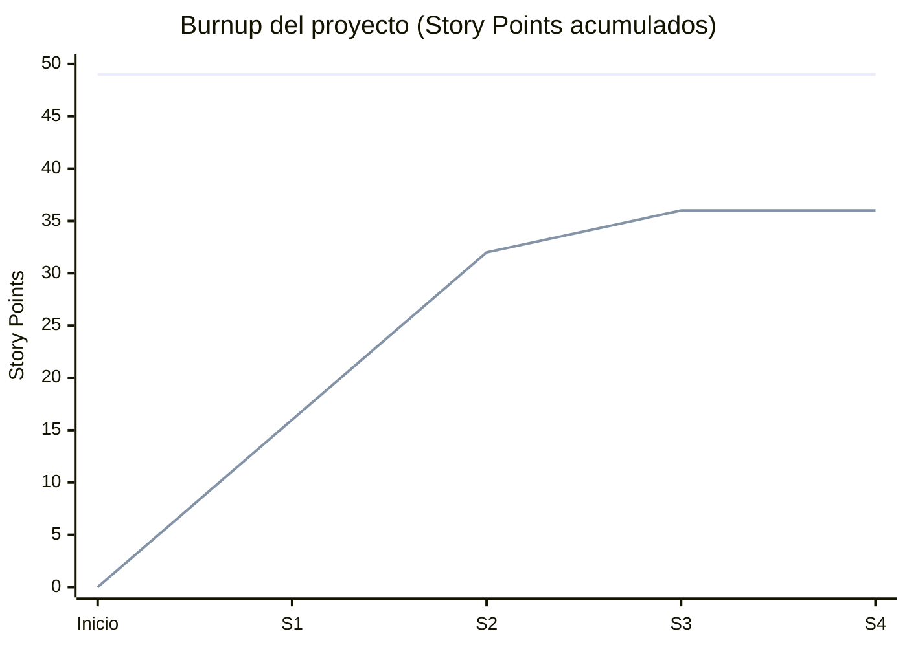

[← Volver al README Principal](../../README.md)

# 05 Radiadores de Información (Information Radiators)

**Proyecto:** EcoLogística Lima – Optimizador de Rutas Sostenibles para DistriRápido S.A.C.  
**Marco Ágil Utilizado:** Scrum adaptado (Sprint 0 de base más cuatro sprints), con tablero
Jira, revisiones y retrospectivas por sprint, complementado con prácticas predictivas de
reporte y control  
**Versión:** 1.0.0

> Los radiadores se reconstruyen con datos reales de los
> [sprints](../03%20Implementación/) y del [tablero Jira](../02%20Planificación/02%20Artefactos%20Jira%20V_1_0_0.md).
> Cuando no existe captura o medición, se dice explícitamente; no se generan imágenes
> artificiales. Serie de cierre: [01 Estado](01%20Reporte%20de%20Estado%20V_1_0_0.md) ·
> [02 Variación](02%20Reporte%20de%20Variación%20V_1_0_0.md) ·
> [03 EVM](03%20Reporte%20de%20Análisis%20de%20Valor%20Ganado%20-%20EVM%20V_1_0_0.md) ·
> [04 Tableros](04%20Tableros%20de%20Control%20-%20Híbridos%20V_1_0_0.md) ·
> [05 Radiadores](05%20Radiadores%20de%20Información%20V_1_0_0.md) ·
> [06 Reporte Final](06%20Reporte%20Final%20del%20Proyecto%20V_1_0_0.md) ·
> [07 Lecciones](07%20Reporte%20Final%20de%20Lecciones%20Aprendidas%20V_1_0_0.md).

## 1. Burndown Chart (Trabajo Restante)

| SP restantes | Inicio | S1 | S2 | S3 | S4 |
|:---|---:|---:|---:|---:|---:|
| Ideal (49 SP en 3 sprints) | 49 | 33 | 16 | 0 | 0 |
| Real | 49 | 33 | 17 | 13 | 13 |

**Análisis de velocidad y tasa de finalización:** la velocidad real fue 16 SP en el
Sprint 1, 16 SP en el Sprint 2 y 4 SP en el Sprint 3; el Sprint 4 no cerró SP del backlog.
La curva real sigue a la ideal durante los dos primeros sprints y se separa en el Sprint 3,
cuando EN-03 (8 SP) quedó parcial por falta de entorno de despliegue. Al cierre quedan
13 SP, de los cuales 5 corresponden a la porción HTTPS de EN-02 y 8 a EN-03. No se trata
de una caída de productividad medible: no hay registros de horas reales, solo SP cerrados.

## 2. Burnup Chart (Trabajo Completado y Cambios de Alcance)

| SP acumulados | Inicio | S1 | S2 | S3 | S4 |
|:---|---:|---:|---:|---:|---:|
| Alcance total (línea base) | 49 | 49 | 49 | 49 | 49 |
| Trabajo completado | 0 | 16 | 32 | 36 | 36 |

**Análisis de crecimiento de alcance vs. trabajo aceptado:** la línea de alcance no
creció ni se redujo en SP: los 49 SP del backlog se mantuvieron como línea base. Los
cambios reales fueron de planificación y documentación —Sprint 0 añadido, Sprint 4
reconducido a calidad, ítems `ET-S4-xx` fuera del backlog y correcciones registradas en el
[CHANGELOG](../../CHANGELOG.md)—, no adiciones de SP. Por eso la brecha final de 13 SP
representa trabajo no aceptado, no alcance nuevo.

## 3. Task Board / Tablero Kanban

*Captura real del tablero Scrum de Jira, conservada como Evidencia 4 en
[Artefactos Jira](../02%20Planificación/02%20Artefactos%20Jira%20V_1_0_0.md). La
descripción del documento de origen aún no indica cuántas tarjetas hay en cada columna;
por eso no se inventa un conteo de WIP.*

**Análisis de flujo y cuellos de botella identificados:** el flujo documentado en Jira es
To Do → In Progress → In Review / QA → Done. Los cuellos de botella observables en las
revisiones no son de columna sino de dependencia externa: EN-02 permaneció parcial desde
el Sprint 1 (HTTPS) y EN-03 desde el Sprint 3 (Staging). La revisión del Sprint 1 registró
un avance interno de 1 %, 27 %, 61 %, 76 % y 76 %, estancado al final por EN-02. No se
dispone de conteos históricos de tarjetas por columna, por lo que no se reporta un WIP
promedio ni un tiempo de ciclo.

## 4. Mood Chart (Estado de Ánimo del Equipo)

| Integrante / Rol | Sprint 1 | Sprint 2 | Sprint 3 | Sprint Final |
|:---|:---:|:---:|:---:|:---:|
| Jhunior Harold Cosme Tenorio — Director de Proyecto | No disponible | No disponible | No disponible | No disponible |
| Jhanpool Ernesto Flores Torres — Backend / Arquitecto | No disponible | No disponible | No disponible | No disponible |
| Ricardo David Tucto Ubaldo — Frontend / UX-UI | No disponible | No disponible | No disponible | No disponible |
| Andrew Steven Vega Reyes — QA & DevOps | No disponible | No disponible | No disponible | No disponible |

**Interpretación del clima laboral:** **no es posible interpretarlo**. No se recolectó
ninguna encuesta, escala de ánimo ni registro de motivación por integrante o iteración;
la búsqueda en la documentación no produjo datos de clima. Completar estas celdas con
valores estimados sería inventar información. Las retrospectivas sí documentan
aprendizajes y acciones, pero no emociones o satisfacción, por lo que no se usan como
sustituto. Tampoco hay resultados SUS: el instrumento quedó preparado y sin aplicar.

## 5. Tableros de Retrospectiva

**Evidencia documental (no hay captura de un tablero físico o digital de retrospectiva):**

- [Retrospectiva Sprint 1](../03%20Implementación/Sprint%2001/04%20Retrospectiva%20del%20Sprint%20V_1_0_0.md)
- [Retrospectiva Sprint 2](../03%20Implementación/Sprint%2002/04%20Retrospectiva%20del%20Sprint%20V_2_0_0.md)
- [Retrospectiva Sprint 3](../03%20Implementación/Sprint%2003/02%20Retrospectiva%20del%20Sprint%20V_1_0_0.md)
- [Retrospectiva Sprint 4](../03%20Implementación/Sprint%2004/02%20Retrospectiva%20del%20Sprint%20V_1_0_0.md)

| Sprint | Lo que funcionó bien | Oportunidades de mejora | Acciones implementadas / estado |
|:---|:---|:---|:---|
| 1 | Adoptar Haversine + Vecino Más Cercano + 2-opt frente a la búsqueda factorial; medir rendimiento desde el inicio (17.9–20.2 ms). | No suponer que el cálculo geográfico o el SLA llegan "gratis"; EN-02 quedó parcial por HTTPS. | IMP-01 e IMP-03 resueltos; IMP-10 y la porción HTTPS permanecen abiertos. |
| 2 | Tratar el `commit()` de una escritura como parte del criterio de aceptación; definir reglas de negocio antes de exponerlas; usar el factor de emisión del vehículo. | Persistencia y reglas de estado requieren verificación explícita, no solo revisión visual. | IMP-S2-01 resuelto el 21/10/2026 con `commit()` explícito. |
| 3 | Distinguir CI de CD y leer coberturas por módulo (backend 60.82 % vs. SonarQube 9.8 %); neutralizar la inyección de fórmulas en CSV. | Un pipeline verde no acredita despliegue; la cobertura global puede ocultar módulos sin pruebas. | CI ejecutada; Staging y Producción siguen omitidos. |
| 4 | Valorar las E2E por lo que verifican; datos únicos y limpieza por API; aserciones basadas en la interfaz real, no en suposiciones. | SUS sin aplicar, Lighthouse solo sobre login, componentes React sin pruebas y cobertura por debajo del objetivo. | `ACT-S4-02` cumplida parcialmente; las otras siete acciones abiertas al 19/11/2026. |

---

[← Volver al README Principal](../../README.md)
